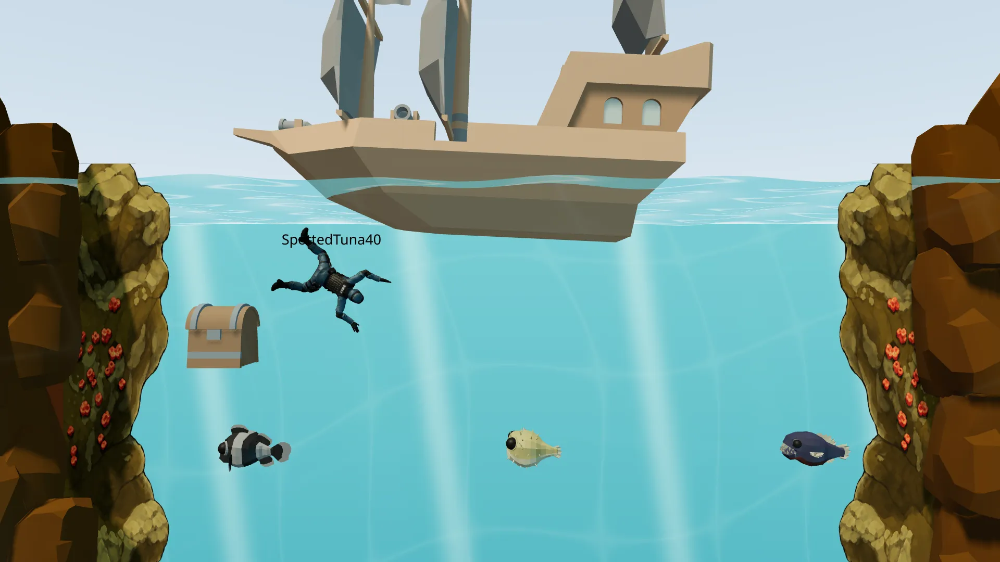
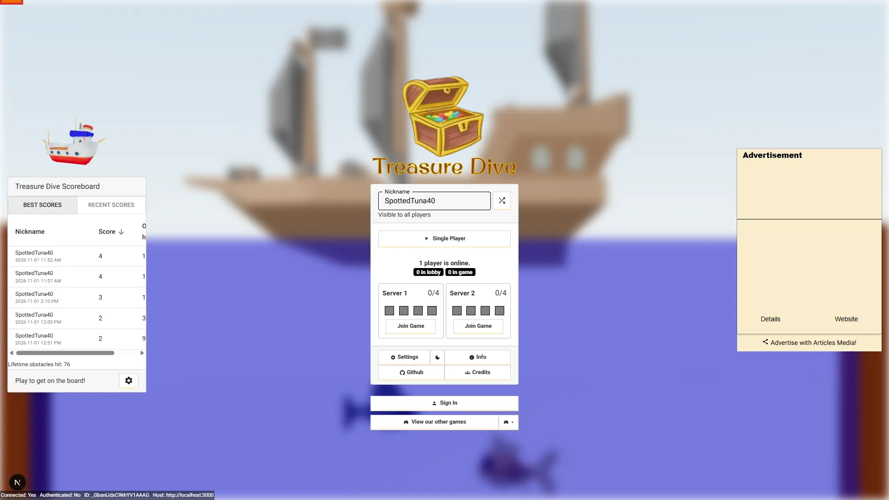
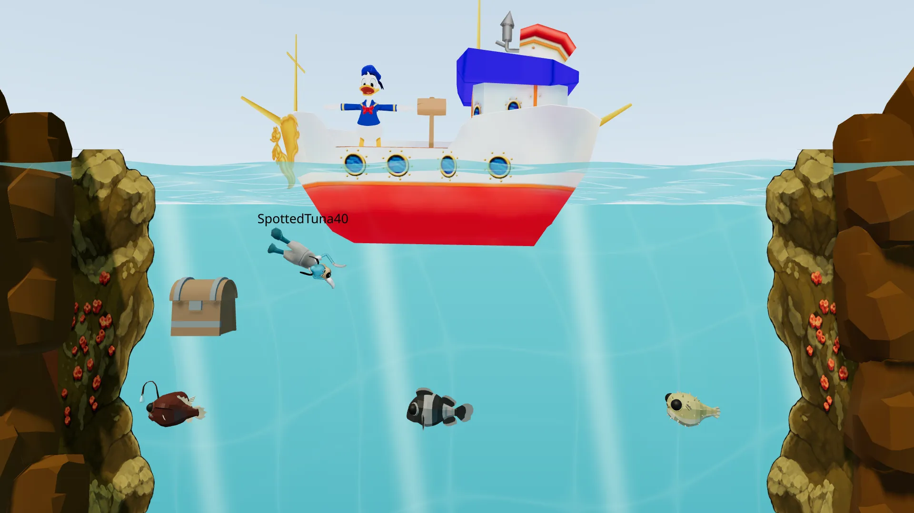
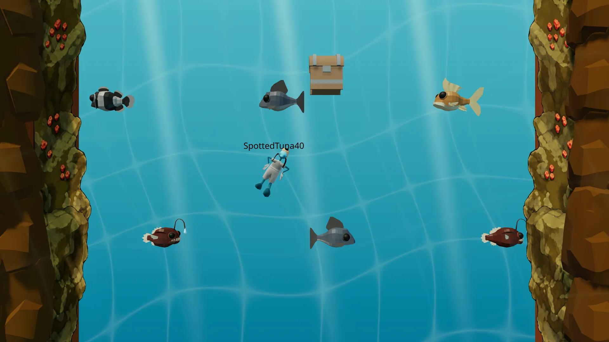
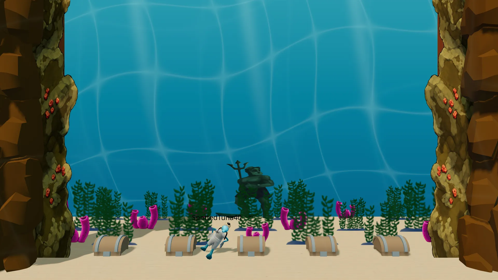
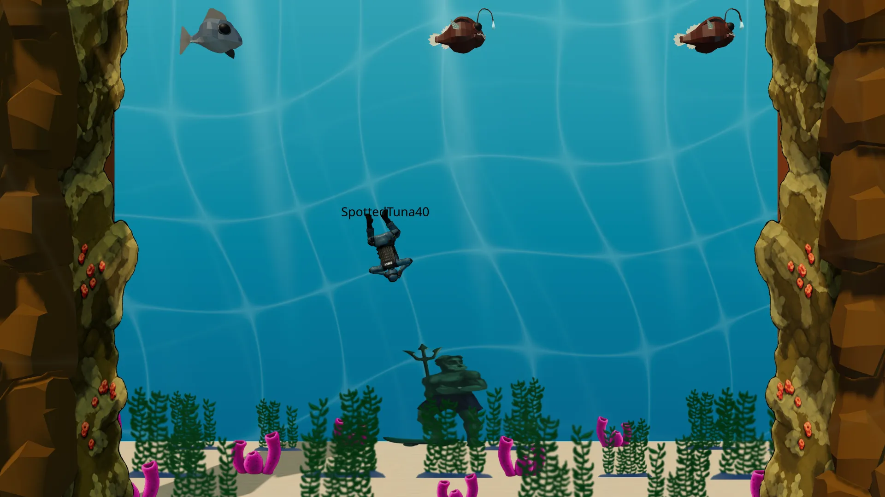
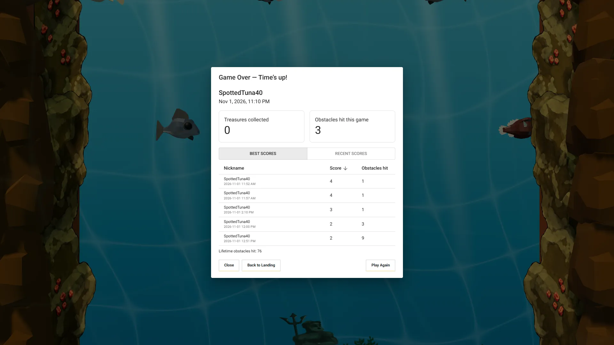

# Treasure Dive



The objective is to collect as many treasure chests from the bottom of the lake and bring it back to the boat within the time limit. Fish obstacles are scattered everywhere, and colliding into a fish will halt the players actions and also drop the treasure chest if one was in possession. The goal is to avoid any obstacle while bringing the treasure chest back safely.

## Getting Started

First you will need to setup a .env file from the .env.sample provided.

Then development server can be run:

```bash
pnpm run dev
```

## Scripts

In the scripts folder is reset_public and sync_to_s3. This is only for Articles Media usage. Allows for putting public folder to CloudFront to lower Vercel charges for the public facing site.

## Multiplayer

Aiming to have multiplayer via P2P as well. Websocket backend code is not in this repo or available at this time.

## Inspiration

Inspired by the Treasure Dive trolley game from Toontown Online

[Wiki link](https://toontown.fandom.com/wiki/Treasure_Dive)

[YouTube video](https://www.youtube.com/watch?v=sknxF-KkKTA)

## Previews








## Attributions

[Rock Model - Quaternius](https://poly.pizza/m/R2UjZAX3By)  
[Fish Models - Quaternius](https://quaternius.com/packs/cutefish.html)  
[Player Model - mixamo](https://www.mixamo.com/)  
[Ship Model - Kenney](https://poly.pizza/u/Kenney)
